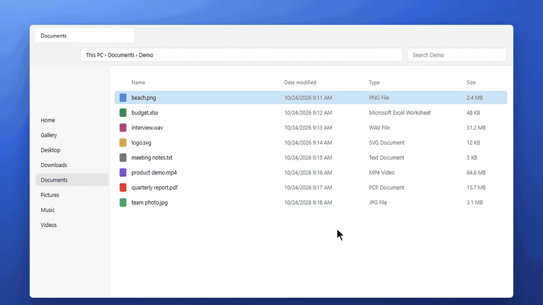

# EFC — Easy File Converter

A file converter for Windows that lives in the background. Select a file in File Explorer, press
**Ctrl + Shift + E**, a glass wheel appears next to the cursor, pick a format and the converted file
shows up in the same folder. No windows, no dialogs.



- Transparent radial wheel with the real desktop blurred behind it, no accent colours.
- Real, local conversions: nothing ever leaves your computer.
- The original is never modified and nothing is overwritten (`photo.jpg` → `photo_converted.jpg` →
  `photo_converted_2.jpg`).
- Progress notification with real progress, "N of M processed", cancel and retry.
- Interface in English and Spanish.

<div id="donate-button-container">
<div id="donate-button"></div>
<script src="https://www.paypalobjects.com/donate/sdk/donate-sdk.js" charset="UTF-8"></script>
<script>
PayPal.Donation.Button({
env:'production',
hosted_button_id:'FWQZSTKY2Q94E',
image: {
src:'https://www.paypalobjects.com/en_US/i/btn/btn_donate_LG.gif',
alt:'Donate with PayPal button',
title:'PayPal - The safer, easier way to pay online!',
}
}).render('#donate-button');
</script>
</div>


---

## 1. Install and try it (no build required)

### Requirements

- Windows 10 (64-bit) or 11. For the most faithful blur, Windows 10 version 2004 or later.
- No Node.js, administrator rights or FFmpeg installation needed: everything is inside the installer.

### Steps

1. Download `EFC-Setup-1.6.0.exe` from the repository's **Releases** section, or build it with
   `npm run dist` (it ends up in `release\EFC-Setup-1.6.0.exe`).
2. Run `EFC-Setup-1.6.0.exe`. First choose the language (**Español** or **English**): the installer
   and EFC use that language. It installs for your user only and starts when it finishes.
   - The installer is **not digitally signed**, so Windows SmartScreen may show "Windows protected
     your PC". Click **More info → Run anyway**.
3. The "EFC is ready" notification appears, along with an icon in the notification area (next to the
   clock).
4. In File Explorer, select a file and press **Ctrl + Shift + E**.
5. Choose the format:
   - with the mouse: click, or drag from the centre and release;
   - with the keyboard: the arrow keys and **Enter**, or the keys **1–8**.

   **Esc**, a click outside or pressing the shortcut again closes the wheel.
6. The result is saved next to the original. Click **Show** to see it in File Explorer.

Shortcut behaviour:

- Outside File Explorer (desktop, browser, Word…) or with no files selected, the wheel does **not**
  appear and the shortcut is passed on to the active application.
- With several tabs open in the Windows 11 File Explorer, the visible tab is used.

**Right-click menu** (in addition to the shortcut): right-click one or more files and choose
**"Convert with EFC"**. The wheel appears next to the cursor with all the selected files.

- On **Windows 10** the entry is directly in the menu.
- On **Windows 11** it is under **"Show more options"** (or **Shift + right-click** to open that menu
  directly). The compact Windows 11 menu only accepts packaged, digitally signed apps, which EFC is
  not yet.
- It only appears on file types EFC can convert, and supports up to 100 files at once (File
  Explorer's limit for this kind of entry).
- If EFC wasn't running, it starts automatically.
- Turn it on or off in **Settings** (see below) or with `contextMenu` in the configuration. It is
  registered for your user only and the uninstaller removes it.

**Settings**: right-click the EFC icon next to the clock → **Settings…** (or just click the icon). A
glass panel appears next to the icon, over the blurred desktop, like Windows' own flyouts. Changes
apply immediately, with no "Save" button; close it with **Esc**, its **×** or by clicking outside.

- **General**: the shortcut (click it, then press the new combination; Esc cancels; it must include
  Ctrl, Alt or Win, except for F1–F24), start with Windows, "Convert with EFC" on right-click and
  **language** (Español or English; the whole app switches immediately).
- **Appearance**: blur the background (of the wheel, notifications and panel), wheel transparency and
  hide EFC in screenshots.
- **Quality**: image quality (Maximum, High or Balanced), PDF-to-image resolution (150, 200 or
  300 dpi) and SHRINK size for photos (1280, 1920 or 2560 px) and videos (480p, 720p or 1080p).
- At the bottom it shows which engines are available: FFmpeg and the Office apps found.
- Start with Windows and "Convert with EFC" can only be changed in the installed version (with
  `npm run dev` they are disabled and say so).

The icon menu contains "Settings…", "Open diagnostic log" and "Quit EFC".

Uninstall: *Settings → Apps → EFC — Easy File Converter → Uninstall*.

---

## 2. Supported formats

| Source | Targets | Engine |
|---|---|---|
| PNG, JPG/JPEG, WEBP, AVIF, BMP, TIFF, GIF | JPG, PNG, WEBP, AVIF, BMP, TIFF, GIF, ICO, PDF | sharp (libvips). BMP and ICO with an in-house codec; PDF with pdf-lib |
| SVG | PNG, JPG, WEBP, AVIF, BMP, TIFF, GIF, ICO | sharp (librsvg) |
| Several images and/or PDFs | **MERGE**: a single PDF with everything, in natural name order | pdf-lib |
| PDF (all pages) | JPG, PNG, WEBP, TIFF (pages to images) and TXT (text) | pdf.js + @napi-rs/canvas |
| PDF | **PDF tools** petal: SHRINK, SPLIT (one PDF per page), ROTATE (90° clockwise) and MERGE | pdf-lib (+ sharp to shrink) |
| Photos and videos (all of the above except SVG) | **SHRINK**: lighter files for email or messaging (for photos, inside the **Tools** petal) | sharp / FFmpeg |
| Text: TXT, LOG, MD, CSV | PDF and DOCX (Word) | pdf-lib + fontkit with the bundled DejaVu Sans Mono font; DOCX generated by EFC |
| Word: DOCX, DOC, RTF, ODT · Excel: XLSX, XLS, ODS · PowerPoint: PPTX, PPSX, PPT, PPS, ODP | PDF | **Microsoft Office installed** (not included): each document is exported by its own app. Without it, it isn't offered |
| MP3, WAV, FLAC, OGG, OPUS, M4A, AAC, WMA, AIFF, AMR | MP3, WAV, FLAC, M4A, OGG, OPUS | FFmpeg 6.1.1 (bundled) |
| MP4, MOV, WEBM, MKV, AVI, WMV, FLV, MPEG, TS, 3GP | MP4, MOV, WEBM, MKV, GIF, and extract the audio to MP3, M4A or WAV | FFmpeg 6.1.1 (bundled) |
| GIF | also MP4 and WEBM | FFmpeg |

How each conversion behaves:

- **Real type**: the format is detected from the content, not the extension. A `.png` that is
  actually a JPEG is treated as a JPEG, and the wheel says so.
- **Only what works is offered**: if an engine isn't available, its formats don't appear. For
  example, without FFmpeg there is no audio or video, and EFC explains why.
- **Multi-page PDFs**:
  - one page → `report.jpg`;
  - several → folder `report (JPG)` with `report-01.jpg`, `report-02.jpg`…;
  - to TIFF, pages of the same size form a single multi-page TIFF.

  Default resolution: 200 dpi.
- **Quality**:
  - JPEG 90, WebP 90 (lossless if the original was lossless), AVIF 60, TIFF LZW.
  - The colour profile and EXIF data are kept.
- **Transparency**: kept in PNG, WEBP, AVIF, GIF, TIFF, ICO and BMP. In JPG it is filled with white.
- **Audio and video**: if the codecs already suit the target container (for example, MOV H.264 →
  MP4), they are copied without re-encoding. Otherwise H.264/AAC (MP4, MOV, MKV), VP9/Opus (WEBM),
  MP3 VBR, FLAC, AAC, Vorbis or Opus is used.
- **Verification**: every result is reopened and checked (dimensions, pages, tracks) before it is
  accepted. It is first written to a hidden temporary file that is deleted if anything fails, so
  there is never an empty or half-written file with the final name.
- **PDF tools** (all local; text stays selectable, nothing is rasterised). A PDF's main wheel shows
  only the target formats; the tools are inside the **PDF tools** petal ("Back" returns to the main
  wheel):
  - **MERGE**: with several PDFs (or PDFs and images) selected, creates `first_merged.pdf` with
    everything, in natural name order ("report 2" before "report 10").
  - **SPLIT**: creates the folder `report (pages)` with `report-01.pdf`, `report-02.pdf`… If the PDF
    has a single page, it does nothing and says so.
  - **ROTATE**: creates `report_rotated.pdf` with every page rotated 90° clockwise (for 180°, rotate
    the result again).
  - **SHRINK**: recompresses the embedded images (what makes scans or photo-heavy PDFs heavy) to at
    most 1920 px as JPEG and creates `report_shrunk.pdf`. Text, vectors and transparent images are
    left untouched. If the PDF only contains text, no copy is created.
  - Encrypted or restricted PDFs can't be modified: the notification explains why. (Converting them
    to images or text does work.)
- **How the wheel is ordered**: target formats first (anything that doesn't fit goes to "More") and,
  at the end of the first ring, a tools petal: **Tools** for images (MERGE, SHRINK) and **PDF tools**
  for PDFs (MERGE, SHRINK, SPLIT, ROTATE). For video, SHRINK stays on the main wheel.
- **File names follow the language**: in English, what EFC creates is called `…_merged.pdf`,
  `…_shrunk.jpg`, `…_rotated.pdf` and `… (pages)`; in Spanish, `_combinado`, `_reducido`, `_girado`
  and `(páginas)`. `_converted` is the same in both languages.
- **SHRINK (for sharing)**: creates `name_shrunk.ext` next to the original.
  - Images: the longest side becomes at most 1920 px (never enlarged) and they are recompressed.
    JPG, WEBP, AVIF, PNG and GIF keep their format (PNG tries a 256-colour palette and full colour and
    keeps the lighter one; GIF and WEBP stay animated; a multi-page TIFF keeps its pages). BMP and
    single-page TIFF, which email barely displays, are saved as JPG (or PNG if they have
    transparency).
  - Videos: H.264/AAC MP4 with the longest side at 1280 px (720p), at most 30 frames per second.
  - The camera orientation is applied and metadata is removed, **including GPS location**.
  - The notification shows the saving ("8.6 MB → 362 KB · −96%"). If the file is already light and
    shrinking it wouldn't save at least 5%, no copy is created and the notification says so.
  - Limits and quality can be changed in Settings or the configuration (`conversion.shrink…`).
- **Text to PDF or Word**:
  - the encoding is recognised (UTF-8, UTF-16 or Notepad's old Windows-1252);
  - the PDF is A4 with a monospaced font, so columns aligned with spaces are preserved; long lines
    wrap and a form feed in the text starts a new page;
  - the DOCX has one paragraph per line in Consolas and edits normally in Word;
  - if the text contains characters the PDF font doesn't have (emoji, Chinese…), they are replaced
    with "?" and the notification says how many. DOCX keeps them all.
- **Word, Excel and PowerPoint to PDF** (requires Microsoft Office; EFC doesn't bundle any document
  engine):
  - At startup EFC checks which Office apps are installed. Each document is only offered if its app
    is present: DOCX needs Word, XLSX needs Excel and PPTX needs PowerPoint. If it's missing, the
    wheel doesn't appear and the notification says what's needed. "Convert with EFC" on right-click
    doesn't appear on those files either.
  - The PDF is created by Office itself, so it looks exactly as if printed from it: Word creates
    bookmarks from headings, Excel includes **all visible sheets** (not hidden ones) with their print
    area, and PowerPoint gives one page per slide.
  - Office runs hidden, opens the document **read-only**, with **macros disabled** and without
    updating external links, and never saves it. Office conversions run one at a time (about 5–10 s
    per document; the notification says "Converting to PDF with Word").
  - A document with an opening password can't be converted: the notification says so without
    showing any dialog. An empty Excel workbook reports that there is nothing to turn into a PDF.
  - If you had Word, Excel or PowerPoint open, they are left alone: EFC uses its own hidden instance
    and closes it when done (PowerPoint only allows one instance; if it's already open, EFC opens the
    presentation without a window inside it and closes it afterwards).
  - In this version Office documents can't be MERGED with PDFs or images: each produces its own PDF.
- **Not supported**: HEIC (because of HEVC codec patents), camera RAW and ICO as a source.
  `docs/ARQUITECTURA.md` (in Spanish) explains how to add formats.

### Dependencies by format

| Formats | Dependency | Licence |
|---|---|---|
| Images, ICO, images to PDF | `sharp` 0.35 (libvips 8.18), `pdf-lib` 1.17 | Apache-2.0 / LGPL-3.0 (libvips) / MIT |
| Text to PDF | `pdf-lib` 1.17, `@pdf-lib/fontkit` 1.1, DejaVu Sans Mono 2.37 font (`resources/fonts`) | MIT / Bitstream Vera and DejaVu free licence |
| PDF to image and text | `pdfjs-dist` 6.2, `@napi-rs/canvas` 1.0 | Apache-2.0 / MIT |
| Audio and video | FFmpeg 6.1.1 "essentials" (gyan.dev), in `resources\ffmpeg` of the installed app | GPL-3.0 |
| Word, Excel and PowerPoint to PDF | The user's Microsoft Office (not included or redistributed), via automation with `resources\office\efc-office.ps1` | — |

The licences and the exact origin of FFmpeg are in `resources/licenses/THIRD-PARTY-NOTICES.md` (and
in the `licenses` and `ffmpeg` folders of the installed app). You can also use another FFmpeg with
`ffmpegPath` in the configuration, or build without FFmpeg (`EFC_NO_FFMPEG=1`).

---

## 3. Development

Requirements: **Node.js 22.13 or later** (includes npm) and an internet connection for `npm install`.

```powershell
npm install          # dependencies (downloads Electron and an FFmpeg for development)
npm run dev          # Vite + Electron with reload; works with the real File Explorer
npm test             # unit tests and conversion tests with real files
npm run test:e2e     # end-to-end tests with real Electron (requires npm run build)
npm run typecheck    # strict TypeScript (main process and interface)
npm run build        # builds the interface and the main process into dist\
npm run dist         # creates release\EFC-Setup-<version>.exe
npm run dist:dir     # packaged version without installer (release\win-unpacked\EFC.exe)
npm run build:helper # rebuilds efc-helper.exe (needs clang or mingw-w64)
npm run prepare:win  # prepares the Windows binaries and downloads FFmpeg (dist does this)
npm run demo:gif     # records docs/demo.gif with the real app (don't touch the mouse meanwhile)
```

Notes:

- `resources\bin\efc-helper.exe` comes prebuilt. Without a compiler, `build:helper` uses that one.
- With `npm run dev` running you can open `http://localhost:5174/wheel.html` in a browser to work on
  the interface with mock data (`?scene=dark&scenario=pdf`, `toast.html?toast=stack`,
  `settings.html`, `&lang=en`…).
- All visible text lives in `src/i18n/es.ts` and `src/i18n/en.ts`; the English dictionary must have
  exactly the same shape as the Spanish one, or it doesn't compile. Code comments are in Spanish.

### Structure

```
electron/
  main/          main process: orchestration, windows, placement, blur, queue, tray, settings, log
  preload/       minimal, safe API exposed to the interface (window.efc)
  windows/       global shortcut, File Explorer helper client, selection validation, context menu, Office detection
    helper/      efc-helper.cpp (native helper) and the PowerShell/C# fallback
  conversion/    conversion engine: formats, detection, modular registry, adapters, isolated process
src/
  components/    radial wheel, petals, centre orb, notifications, settings panel, icons
  animations/    springs (linear() curves) and wheel choreography
  i18n/          interface text in Spanish and English
  styles/        visual system (neutral glass, light and dark themes, high contrast)
  types/         shared types (formats, IPC contract)
tests/           unit tests, conversion tests with real files and end-to-end tests
scripts/         development, build, native helper, Windows preparation
resources/       prebuilt helper, icons, licences and installer customisation
docs/            architecture and decisions (in Spanish)
```

---

## 4. Configuration

The usual options are changed in **Settings** (section 1). Everything else is in
`%APPDATA%\EFC\config.json`: if you edit it by hand, quit EFC and start it again so it reads the
file. Any invalid value is replaced with the default.

| Key | Default | Description |
|---|---|---|
| `shortcut` | `CommandOrControl+Shift+E` | Global shortcut (Electron format) |
| `launchAtLogin` | `true` | Start with Windows |
| `trayIcon` | `true` | Icon in the notification area |
| `backdropBlur` | `true` | Blur the desktop behind the wheel, notifications and settings panel |
| `wheelTransparency` | `50` | Transparency of the wheel's glass (0 more opaque, 100 more transparent) |
| `language` | `"es"` | Interface language: `"es"` or `"en"`. On first run, the one chosen in the installer or, without the installer, Windows' language |
| `excludeFromScreenCapture` | `true` | Hide the wheel and notifications from screenshots and screen recordings, so the blur only shows what's behind them (see below) |
| `passThroughShortcut` | `true` | Pass the shortcut on to the active application outside File Explorer |
| `contextMenu` | `true` | "Convert with EFC" entry in File Explorer's right-click menu |
| `ffmpegPath` | `null` | Path to a specific `ffmpeg.exe` |
| `maxConcurrentJobs` | `2` | Simultaneous conversions (1–4) |
| `conversion.jpegQuality` / `webpQuality` / `avifQuality` | `90` / `90` / `60` | Quality |
| `conversion.pdfDpi` | `200` | PDF-to-image resolution (72–600) |
| `conversion.svgMinSize` | `1024` | Minimum longest side when rasterising small SVGs |
| `conversion.shrinkMaxSide` | `1920` | SHRINK: maximum longest side of images (px) |
| `conversion.shrinkQuality` | `80` | SHRINK: JPG, WEBP and PNG quality (30–95) |
| `conversion.shrinkVideoMaxSide` | `1280` | SHRINK: maximum longest side of videos (1280 = 720p) |
| `conversion.shrinkVideoCrf` | `28` | SHRINK: video compression (23 higher quality, 32 lighter) |
| `verboseLog` | `false` | Detailed log |

About `excludeFromScreenCapture`: the blur is based on a capture of the screen area behind the
window. So that this capture doesn't include the wheel or notifications themselves, EFC asks Windows
to exclude its windows from captures (Windows 10 2004 or later). That's why they don't appear in
screenshots, recordings or remote desktop tools that work by capturing the screen. If you need to
record EFC on video, set it to `false`.

---

## 5. Privacy and security

- Everything is processed locally. EFC makes no network requests.
- The capture used for the blur is taken at half resolution, only of the area needed, only in memory
  and only while the wheel or notification is visible. It is never saved or sent.
- The interface is isolated:
  - `contextIsolation` on, `nodeIntegration` off, `sandbox` and CSP;
  - the exposed API only allows the necessary operations, and the main process checks the origin of
    every message.
- Paths and file names are validated: no `\\?\`, `\\.\`, NTFS alternate data streams, invalid
  characters, virtual items (inside a ZIP) or shortcuts.
- FFmpeg is launched with separate arguments and no command interpreter. File contents are never
  executed.
- With Office, macros are disabled before the document is opened (`AutomationSecurity` = force
  disable), external links aren't updated and the document is opened read-only. Paths are passed to
  the script through environment variables, never inside a command. EFC only closes the Office
  instances it opened itself (those with `/Automation`), never the user's.
- Conversions run in a separate process (`utilityProcess`). If it crashes, it doesn't take the app
  down with it, and its temporary files are cleaned up.

---

## 6. Troubleshooting

The log is at `%APPDATA%\EFC\logs\efc.log`. With `"verboseLog": true` it is more detailed (the log
itself is written in Spanish).

| Symptom | What to do |
|---|---|
| "Shortcut unavailable" notification | Another application uses that combination. Change the shortcut in Settings. |
| "Detection unavailable" notification | Check the log. If your antivirus blocks `efc-helper.exe`, EFC tries to use PowerShell; if PowerShell is restricted by your organisation, detection can't work. |
| No audio or video on the wheel | FFmpeg isn't available. The bottom of the Settings panel shows whether it was found. |
| The wheel has no blur | The capture took too long or is disabled (`backdropBlur`). A more opaque glass is used instead. |
| The wheel doesn't appear in a screenshot | This is intentional (see `excludeFromScreenCapture`). |
| A Word, Excel or PowerPoint file says Office is required | EFC didn't find that app at startup. If you just installed Office, quit EFC and start it again. The log says "Office disponible para PDF: …". |
| "Microsoft Office couldn't be started" or "Office couldn't create the PDF" | Open that document in Office once (activation or a prompt may be pending) and retry. The technical detail is in the log. If your organisation blocks PowerShell scripts, Office conversion can't work. |

---

## 7. Verification status

### Automated tests on real Windows 10 (1.6.0: English)

| Test | Result |
|---|---|
| `npm run typecheck` | No errors. The English dictionary must have exactly the same shape as the Spanish one: if a text is missing, it doesn't compile |
| `npm test`: 213 tests. New: both dictionaries have the same texts and none is empty; no Spanish text is left in English; initial language from the installer (3082/1034 Spanish, 1033/2057 English) or otherwise from Windows; sizes and percentages formatted per language ("1,2 MB · 40 %" and "1.2 MB · 40%"); targets, tools, explanations, progress/result/error notifications, shortcut keys and settings messages in English; "Convert with EFC" in the context menu (re-registered when the language changes); real files with English names (`_rotated`, `_merged`, `(pages)` folder, "page 1" title) and Spanish names (`_girado`) | 212 passed, 1 skipped (encrypted PDF: needs `qpdf`) |
| `npm run test:e2e` (22 steps). New: English is chosen in the Settings panel with a real click; the panel switches to "Settings" immediately, the wheel shows "Tools" and "More", and the conversion ends with the "Saved" notification | 22/22 |
| Installer with the language dialog | Builds correctly; the dialog and EFC's language after installing are checked by hand (steps 37 to 40) |

### Automated tests on real Windows 10 (1.5.0: Settings)

| Test | Result |
|---|---|
| `npm run typecheck` | No errors |
| `npm test`: 203 tests. New: translation between config.json and the panel (quality levels, hand-edited values shown as "Custom", rejection of values that aren't one of the options), shortcuts (need Ctrl, Alt or Win except F1–F24; whatever the interface accepts the main process accepts too), wheel transparency, old config.json without the new keys, and panel placement with the taskbar at the bottom, top, side and with the icon in "^" | 202 passed, 1 skipped (encrypted PDF: needs `qpdf`) |
| `npm run test:e2e` (21 steps). New: the panel opens against the taskbar without overflowing or needing to scroll, and with real clicks and keys it changes blur, quality, video size, transparency and the shortcut (a key without Ctrl/Alt/Win is rejected with a message; Ctrl + Shift + K is accepted and shown immediately); every change is saved in config.json; Esc closes it | 21/21 (if the mouse is used during the test, the "hover over a petal" step may fail: the wheel follows the real mouse) |

Not testable automatically: opening it from the real tray icon and closing it by clicking outside
(checklist, steps 31 to 36).

### Automated tests on real Windows 10 (1.4.0)

Windows 10 Pro 22H2 with Microsoft 365 (Office 16, 32-bit).

| Test | Result |
|---|---|
| `npm run typecheck` | No errors |
| `npm test`: 191 tests. In addition to the earlier ones: content detection of DOCX/XLSX/PPTX (ZIP), ODT/ODS/ODP (OpenDocument), DOC/XLS/PPT (CFB), RTF and encrypted documents; registry (only with the Office app installed) and context menu per app. With **real Office**: the 11 formats (DOCX, DOC, RTF, ODT, XLSX, XLS, ODS, PPTX, PPSX, PPT, ODP) to PDF with their page count and text read back (accents, ñ, ¿¡); Excel with all visible sheets and without the hidden one; a mixed batch of Word, Excel and PowerPoint; password-protected Word, Excel and PowerPoint documents and an empty Excel workbook (clear message, no dialogs or files); cancelling at 0.3 s, 1.5 s and 4 s without leaving a PDF, temporary files or Word running; paths with spaces, ñ, `&`, `#` and parentheses; the original doesn't change | 190 passed, 1 skipped (encrypted PDF: needs `qpdf`, which isn't available on Windows) |
| `npm run test:e2e`: real Electron (20 steps). New: a DOCX opens the wheel with a single PDF petal, the notification says "Converting to PDF with Word" and the PDF is created. Context-menu requests are now tested with a Windows named pipe | 20/20 |
| Office without windows or leftovers: with 64-bit PowerShell and 32-bit Office (the most common combination, where Office's type library doesn't load), without leaving Office processes open after success, error or cancellation | Correct |

Tested by hand on Windows: versions 1.0 to 1.3.0, including "Convert with EFC" on right-click, and
1.4.0's Office-to-PDF conversion.

1.4.1 fixes the wheel with a single target (for example, a Word document, which only offers PDF):
the ring looked misaligned, with a circle sticking out at the top. A geometry test and the Word step
of `test:e2e` cover it.

### Automated tests (earlier development environment, Linux)

| Test | Result |
|---|---|
| `npm run typecheck` (main process and interface) | No errors |
| `npm test`: 162 unit and conversion tests that create real files and reopen them to check them (dimensions, pages, tracks, transparency, EXIF, name collisions, cancellation, damaged files, 3-page PDF, 24 MP, audio and video with FFmpeg, UTF-8/UTF-16/Windows-1252 text to PDF and DOCX with the content read back, SHRINK for photos, PNG, animated GIF, multi-page TIFF, BMP and videos with GPS and metadata removal, MERGE PDFs and images, SPLIT, ROTATE and SHRINK scanned PDFs, encrypted PDFs, petal grouping, context-menu registration and its sync with the uninstaller, request server and file batching) | 162/162 |
| `npm run test:e2e`: real Electron 44 with transparent windows, real clicks and keys, conversion and checking the files on disk (19 steps: offered formats, hover, Esc, click outside, "More" and "Back", PNG→JPG, `_converted` without overwriting, long name with accents, 3-page PDF → folder with 3 JPGs, SPLIT a PDF, MERGE two PDFs, ROTATE, MERGE images into a PDF, damaged file with "Retry", TXT→PDF and TXT→DOCX, SHRINK a 12 MP photo and a Full HD video, WAV→MP3, cancel MP4→WEBM without leaving files; PDF tools are used by entering their petal; two simultaneous context-menu requests open a single wheel with both files) | 19/19 |
| Installer `EFC-Setup-1.3.0.exe` run under Wine 10 (simulated Windows 10): installs per user in `%LOCALAPPDATA%\Programs\efc-easy-file-converter`, creates the Start menu shortcut and start-with-Windows entry; the installed version starts, the native helper responds, it detects the bundled FFmpeg 6.1.1 and the self-check of sharp (native Windows build) and pdf.js passes; the uninstaller removes the files, the shortcut and the start-with-Windows entry | Correct |
| Context menu under Wine: EFC registers "Convert with EFC" per user (50 extensions, command with the launcher's exact path); two launchers at once take 122 ms and EFC receives both files together; if EFC isn't running, the launcher starts it and passes the file; paths with accents, ñ and emoji intact; the menu survives updates and disappears on uninstall. (Wine can't show the wheel's transparent window, from the menu or the shortcut: that's checked on real Windows) | Correct |
| Native helper protocol under Wine: 1–3 ms response times, capture with negative coordinates (monitor on the left), overlapping requests, orderly shutdown | Correct |

### Not yet verified automatically (needs real Windows)

These couldn't be verified automatically:

- reading the real File Explorer selection (Windows 11 tabs, desktop);
- the global shortcut, focus and passing the shortcut on to other applications;
- transparency and blur with DWM, and capture exclusion;
- DPI scaling and multiple monitors;
- the installer and SmartScreen;
- `prefers-reduced-motion` with the Windows setting.

The logic of each of these is tested separately. When you try it, the log (`efc.log`) records what
happened on every press of the shortcut.

### Windows checklist

Use a few sample files of your own (a photo, a 3-page PDF, a text file, audio, video, Office
documents…).

| # | Test | How | Expected result |
|---|---|---|---|
| 1 | Selection in File Explorer | Select a PNG image and press Ctrl+Shift+E | The wheel appears next to the cursor with JPG, WEBP, PDF, ICO, AVIF, TIFF, "Tools" and "More" (BMP, GIF) |
| 2 | Outside File Explorer | Press the shortcut on the desktop and in the browser | The wheel doesn't appear; the other application receives the shortcut |
| 3 | No selection | In a folder with nothing selected, press the shortcut | The wheel doesn't appear |
| 4 | Real conversion | Choose JPG | A `.jpg` appears and opens in the photo viewer |
| 5 | No overwriting | Repeat the conversion to JPG | `…_converted.jpg` appears; the first one doesn't change |
| 6 | Long name and accents | Use a long file name with accents and ñ → WEBP | Name abbreviated in the orb without distorting it; file created |
| 7 | Multi-page PDF | A 3-page PDF → JPG | Folder `… (JPG)` with 3 images |
| 8 | Several images | Select two images → Tools → MERGE | `…_merged.pdf` with 2 pages |
| 9 | Damaged file | A damaged PNG → JPG | Persistent error notification with "Retry"; no file created |
| 10 | Text | A `.txt` → PDF and → DOCX | The wheel offers PDF and DOCX; the PDF and the Word document open with the correct text and accents |
| 11 | Audio | A `.wav` → MP3 | A playable `.mp3` |
| 12 | Video and progress | A short `.mp4` → WEBM | Notification with a real bar and "0 of 1 processed · NN%"; playable result |
| 13 | Cancel | During the video conversion, click × on the notification | It stops and leaves no file |
| 14 | Large image | A 24 MP JPG → PNG | Converts without freezing the wheel or File Explorer |
| 15 | Closing and placement | Esc, click outside and the shortcut again; try near an edge and on another monitor | The wheel closes with an animation and leaves nothing behind; it's always fully on screen |
| 16 | Shrink a photo | A phone photo → Tools → SHRINK | `…_shrunk.jpg` at 1920 px; the notification shows the saving; Properties → Details no longer has a GPS location |
| 17 | Shrink a video | A phone video → SHRINK | `…_shrunk.mp4` in 720p, with sound and correctly oriented |
| 18 | Merge PDFs | Select two PDFs (or PDFs and images) → PDF tools → MERGE | `…_merged.pdf` with all the pages, in name order |
| 19 | Split and rotate | A multi-page PDF → PDF tools → SPLIT; then → ROTATE | `(pages)` folder with one PDF per page; `…_rotated.pdf` rotated clockwise |
| 20 | Shrink a scanned PDF | A scanned or photo PDF → PDF tools → SHRINK | `…_shrunk.pdf` much lighter and readable; selectable text is kept |
| 21 | Right-click menu | Right-click a photo → "Convert with EFC" (on Windows 11, inside "Show more options") | The wheel appears next to the cursor |
| 22 | Menu with several files | Select 3 photos → right-click → "Convert with EFC" | A single wheel with "3 files" |
| 23 | Menu with EFC closed | Quit EFC from its icon and repeat step 21 | EFC starts by itself and shows the wheel |
| 24 | Word to PDF | One of your own Word documents (with headings, tables or images) → PDF | The wheel only offers PDF; the notification says "Converting to PDF with Word"; the PDF looks as when printed and has bookmarks from the headings |
| 25 | Excel to PDF | An Excel file with several sheets → PDF | A single PDF with all visible sheets |
| 26 | PowerPoint to PDF | A presentation → PDF, first with PowerPoint closed and then with another presentation open in PowerPoint | One page per slide; your open PowerPoint stays the same and no new window appears |
| 27 | Office open | With one of your Word documents open and unsaved, convert another Word document | Your Word doesn't close or lose anything |
| 28 | Right-click on Office | Right-click a .docx, .xlsx and .pptx | "Convert with EFC" appears |
| 29 | With password | A password-protected Word document → PDF | "The document is password-protected" notification, with no Office dialog |
| 30 | Several at once | Select a Word, an Excel and a PowerPoint file → PDF | Three PDFs, one per document |
| 31 | Open Settings | Right-click the EFC icon next to the clock → "Settings…"; then just click the icon | The glass panel appears against the taskbar, above the icon, with the blurred desktop behind. The menu only has Settings, log and Quit |
| 32 | Close | Esc, the × and a click outside the panel | It closes with a short animation in all three cases |
| 33 | Change the shortcut | Click the shortcut in the panel and then press Ctrl + Alt + C; try the wheel with it. Repeat with a single letter | The wheel opens with the new one; the single letter shows "Combine it with Ctrl, Alt or Win." and nothing changes |
| 34 | Transparency | Move the transparency to one end and open the wheel; then to the other | The wheel looks more transparent or more opaque; notifications don't change |
| 35 | Quality and SHRINK | Choose "Maximum" and convert a photo to JPG; choose 480p and shrink a video | Heavier JPG than with "High"; video shrunk to 480p |
| 36 | Remembered | Quit EFC and start it again | The settings stay as you left them |
| 37 | Language in the installer | Run the installer and choose **English** | The installer is in English; EFC starts in English ("EFC is ready" notification, icon menu with "Settings…", wheel with "More", "Tools"…) |
| 38 | Change language | Settings → Language → Español | The panel switches immediately; the next wheel, the notifications and the icon menu are in Spanish; right-click → "Convertir con EFC" |
| 39 | English names | In English, ROTATE and SPLIT a PDF, and SHRINK a photo | `…_rotated.pdf`, a `… (pages)` folder and `…_shrunk.jpg` |
| 40 | Update | Install again choosing the other language | EFC starts in the language chosen this time |

If something fails, `%APPDATA%\EFC\logs\efc.log` is the most useful file for fixing it.

---

## 8. Licence

EFC is distributed under the **GNU GPL v3.0 or later** licence (`LICENSE` file). It's the licence
consistent with FFmpeg, which is bundled in the installer under the GPL. The licences of the other
components are in `resources/licenses/THIRD-PARTY-NOTICES.md`.
